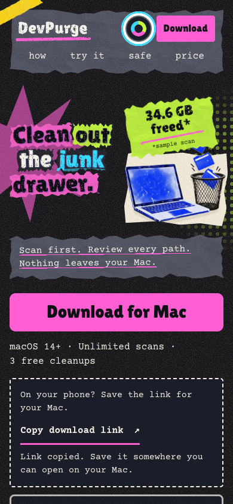
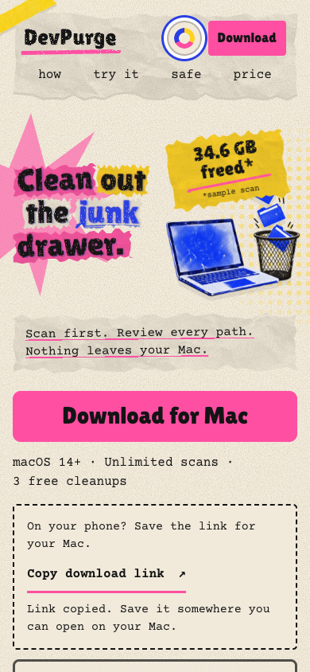

# Download clarity, phone handoff and launch acceptance

Checked 2026-10-30. Items 2 and 3 are implemented. Items 4 and 5 are partial;
physical-device testing, VoiceOver speech and an actual product recording remain
open. This report does not certify those checks as passed.

## Implemented

- Hero action: **Download for Mac**, with **macOS 14+ · Unlimited scans · 3 free
  cleanups** immediately below. Each phrase stays together when wrapping.
- Phone/tablet-width and coarse-pointer visitors get a **Copy download link**
  control. Direct download remains available. No user-agent sniffing or tracking.
- Confirmed copy uses a polite status region. If modern clipboard access fails,
  a checked legacy copy is attempted; if that fails or throws, a labelled,
  selected read-only URL field stays visible. It never falsely reports success.
  Without JavaScript, the direct link and touch-and-hold instructions remain.
- The existing real-app screenshot walkthrough now includes an expandable text
  explanation of Scan, Review, Trash and Finder's Put Back, including the fact
  that files still in Trash continue using storage. This is explanatory copy,
  not a transcript of a recording that has not happened.

## Verification

Host: macOS 27.2 (26B123). Automated browser: Chrome 156.0.8078.79.
Native accessibility-tree inspection: BrowserOS neo 0.51.2.3.

1. **32 layout cases passed:** 320×568, 375×812, 390×844, 430×932, 560×850,
   768×1024, 844×390 and 1440×960, each in Zine, Citrus, Blacklight and Ember.
   No document overflow; headline and laptop retain separate columns; image and
   controls fit; phone targets are at least 44px; theme colors match palettes.
   This matrix ran after the download controls were added.
2. **Copy checks passed:** modern API success; permission denial with successful
   legacy copy; both APIs failing; legacy copy throwing; retry from manual mode;
   and a real Chromium clipboard read matching the complete DMG URL. Mocked
   failure checks exercise the actual production click handler.
3. **Keyboard checks passed:** Enter opens palette options, Tab reaches swatches,
   Escape closes and returns focus; walkthrough arrows/Home/End move selection;
   Enter opens the text guide and FAQ; sample selection and Trash action report
   demo-only behavior; copy failures focus/select the manual field.
4. **Progressive enhancement:** no-JS direct download and manual instructions
   passed at 320px. Reduced-motion emulation kept hero content visible and
   decorative translation disabled. No page JavaScript errors were observed.
   Native AX inspection exposed the new offer, copy button and text disclosure.
5. **Offer/release evidence:** app bundle reports macOS minimum 14.0;
   `LicenseConfig` defaults to three free cleanups and `LicenseManager` does not
   charge scans against that allowance. GitHub's public v3.3.1 release reports
   `DevPurge-3.3.1.dmg` uploaded (1,224,938 bytes), matching the copied URL.
   Download/install/Gatekeeper acceptance is a separate signing task.

The behavioral regression script is `scripts/test_landing_download.cjs`. It
uses an existing Puppeteer installation; no dependency was added to the site.
Serve `site/` locally, then run with your installed browser/module locations:

```sh
python3 -m http.server 8766 --bind 127.0.0.1 --directory site
```

In another terminal:

```sh
NODE_PATH=/opt/homebrew/lib/node_modules/puppeteer-mcp-server/node_modules \
CHROME_PATH='/Applications/Google Chrome.app/Contents/MacOS/Google Chrome' \
node scripts/test_landing_download.cjs
```

`SITE_URL` and `QA_OUTPUT` override the URL and artifact directory. Defaults are
loopback port 8766 and a fresh temporary directory. The script writes captures
and JSON results. Run against an isolated test browser; it tests clipboard writes.

## Remaining acceptance and concrete blockers

| Check | Evidence / next requirement |
| --- | --- |
| Actual iPhone Safari | Paired iPhone 14 Pro Max, iOS 26.6.1. Device tooling returned “The developer disk image could not be mounted on this device.” iPhone Mirroring opened initial setup; setup was not completed. Requires accessible phone/browser, not desktop emulation. |
| Actual Android Chrome | No Android automation/device access available; `adb` is not installed. Requires an accessible Android phone. |
| VoiceOver on Mac | Native Safari and VoiceOver attachment returned `timeoutReached`. Browser accessibility-tree and keyboard checks are recorded above, but spoken output and live-region announcements were not verified. |
| Actual screen recording | DevPurge attachment timed out via exact running-app path and display name, including after the user confirmed the dashboard was visible. Finder and BrowserOS native control worked. No sample cleanup or recording was performed. |
| Beta-user quotes | No permissioned quotes supplied. None invented or published. |

## Recording acceptance when native control is restored

Use only a newly created sample project/cache. Record the real app scanning,
select only that sample path, inspect the review sheet, confirm **Move files to
Trash**, then restore the same item using Finder **Put Back**. Verify its bytes
before and after. Keep unrelated paths, account details and desktop notifications
out of the capture. Do not select all safe locations on the user's real scan.

Publish a short controlled-playback recording with captions, a poster and the
existing equivalent text guide. Label sample data honestly; do not add an invented
reclaimed-space total or present the current screenshots as a live recording.

## Captures




