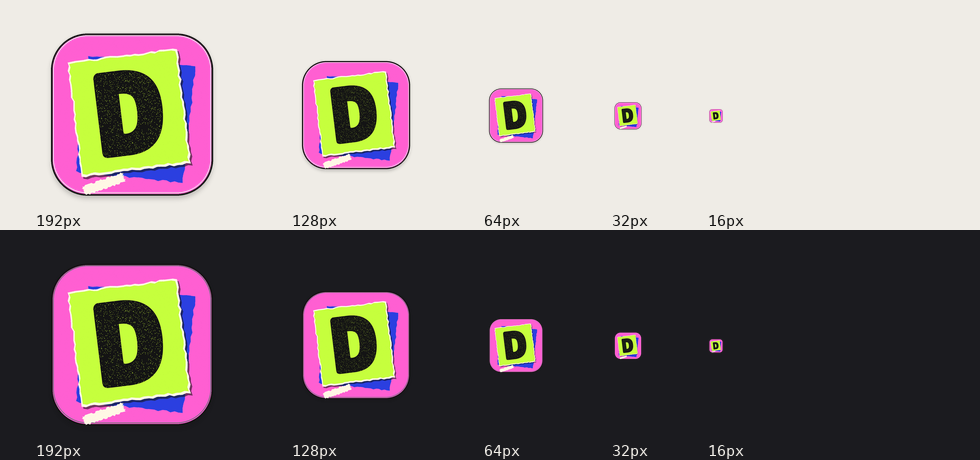

# Zine Mac app icon

Updated 2026-10-31. The paper-cut D extends the website's D identity and the
chosen Zine/Blacklight visual language: pink `#FF5FD2`, lime `#C6FF3D`, cobalt
`#2B3FE0`, paper `#FFF7E5` and ink `#141414`. The glyph uses the same bundled
OFL-licensed Lilita One face as the app. Sparse ink wear and torn edges provide
texture; the large D retains its silhouette at 16px.

## Build

```sh
python3 scripts/generate_app_icon.py
```

Requires Pillow and macOS `iconutil`. No network asset or image-generation
service is required. Outputs:

- `mac/Resources/AppIcon.png`: transparent 1024px master.
- `AppIcon.icns`: ten standard iconset representations, 16–1024px.

`scripts/build_mac_app.sh` already copies the root ICNS into the app bundle.
The generator uses a temporary iconset and deterministic seeds; repeated runs
produce the same ICNS bytes. It does not edit a running app or publish a release.

## Local application and checks

Applied the resource to the repository's `DevPurge.app` and
`~/Desktop/DevPurge.app`. Both were already ad-hoc signed; after replacement,
both passed `codesign --verify --deep --strict`. Their existing versions and app
logic were retained. Each full app bundle was backed up first under the temporary
directory `devpurge-icon-backup-lrg33fuk` (its `manifest.json` maps the two copies).

LaunchServices was refreshed for each copy. An AppKit `NSWorkspace.icon(forFile:)`
render of the Desktop app resolves the new design, not the old limestone icon.
No running app was quit and no global Dock/Finder cache was deleted. A currently
running app may retain its old Dock image until it is quit and reopened.

ICNS extraction verified ten PNG representations with sizes 16, 32, 64, 128,
256, 512 and 1024, with transparent corners. Deterministic regeneration and
`git diff --check` passed. Source and local copies are updated; the public v3.3.1
DMG is unchanged and needs a separate release to carry this icon to new downloads.



