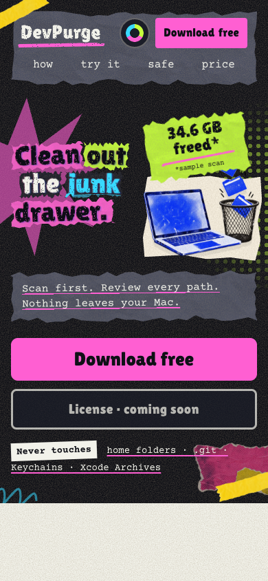

# Mobile hero composition

2026-10-30. Supersedes the stacked hero artwork shown in `mobile-layout-qa.md`.

## Design

The headline and laptop share one opening row through 860px. Supporting copy,
actions and the safety line have full-width rows beneath them. The laptop stays
beside the headline even at 320px. A smaller sample badge, quieter background
decoration and a paper offcut in dark palettes preserve the collage identity
while improving hierarchy and artwork contrast. Mobile hero elements render
at their final rotations immediately, so a below-fold entrance does not tilt
the first download action.

## Verification

Headless Chrome checked eight viewport sizes with touch emulation through 860px:
320×568, 375×812, 390×844, 430×932, 560×850, 768×1024, 844×390 and 1440×960.
All four palettes were selected through the visible palette menu at each size.
All 32 cases passed: no horizontal document overflow; headline and laptop share
a row without overlapping; the image loads within the viewport; navigation and
actions fit; mobile controls remain at least 44px; and browser theme color
matches the chosen palette. Mobile supporting text and actions clear the artwork.

Reduced-motion emulation retained visible headline content, no laptop translation
and no horizontal overflow. No page JavaScript errors were observed. The desktop
composition remains outside the changed media query. `git diff --check` passed.
Final phone captures also verify the first download action fits the 320×568
viewport after removing the entrance offset.

These are browser-emulation checks. Physical iPhone/Android and screen-reader
testing were not performed. Checkout remains disabled as before.

## Captures

