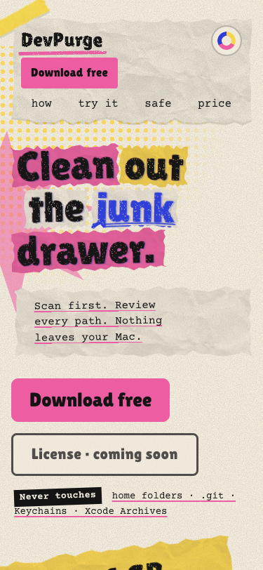

# Landing page mobile layout verification

Date: 2026-10-30. Scope: `site/index.html`, `site/styles.css`, `site/main.js`.

## Changes

- Explicit two-row phone navigation instead of a third download-button row.
- Full-width phone hero actions and an in-flow pricing action that fits 320px.
- Minimum 44px phone navigation, review, CLI and footer targets; coarse-pointer controls receive equivalent sizing and press feedback.
- Safe-area padding, palette-aware browser theme color, and a scrolling header on short landscape viewports.
- Desktop hover treatments for review chips and the copy button only apply to a fine pointer with hover support.

## Layout evidence

Local browser viewport checks: 320×568, 375×812, 390×844, 430×932,
768×1024, 844×390, 932×430, 1024×768 and 1440×960.

All nine had document width equal to viewport width. Sampled headings, action
buttons, note labels and CLI cards stayed inside the viewport. Phone layouts
through 860px had no sampled controls below 44px in either dimension. Wider
fine-pointer layouts retain their existing compact controls; a coarse-pointer
media query enlarges the interactive navigation, review and CLI controls.

The logo's decorative underline contributes 6px of scrollable overflow inside
its own element; the wordmark itself was visually intact. Reveal transitions
were completed before final geometry measurements. These measurements establish
final layout, not every intermediate animation frame.

The 375×812 hero was visually inspected after the change:

Before the change, the same width used three navigation rows:

## Checks and limits

`node --check site/main.js` and `git diff --check` passed.
The page still allows browser zoom; no maximum-scale or user-scalable restriction
was introduced. Existing responsive application screenshots remain in place.

This pass used a desktop browser at resized viewports. Physical iPhone/Android,
notch insets on hardware, a fresh full palette/demo/clipboard interaction
regression, and a fresh reduced-motion/device-browser pass were not performed.
